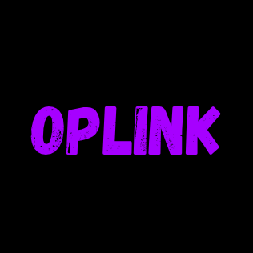
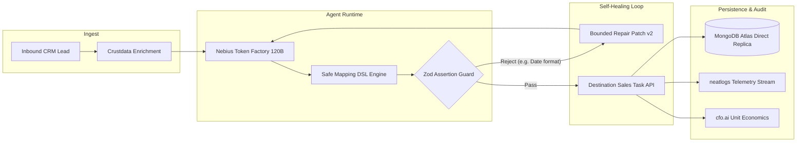

# OPLINK — Autonomous Integration Engineering Agent

<p align="center">
  
</p>

<p align="center">
  <strong>Autonomous AI agent that connects disconnected business tools, automatically generates schema mappings, enriches records with real-time company intelligence, and self-heals broken fields in real time with independent destination verification.</strong>
</p>

<p align="center">
  <a href="#core-features">Features</a> •
  <a href="#architecture">Architecture</a> •
  <a href="#quick-start">Quick Start</a> •
  <a href="#evaluation--demo-walkthrough">Demo Walkthrough</a> •
  <a href="#api-reference">API Reference</a> •
  <a href="#license">License</a>
</p>

---

## Overview

Growing businesses lose hundreds of hours copying prospect leads and company data between disconnected CRMs, task managers, and ERPs. When API schemas evolve or data fields arrive in unexpected formats (e.g., non-ISO dates, missing custom attributes), traditional static webhooks fail silently.

**OPLINK** solves this by acting as an autonomous integration runtime:
1. **Ingest**: Inbounds prospect data from CRMs (HubSpot, Salesforce, webhooks).
2. **Enrich**: Augments lead context with live headcount, industry, and revenue data via **Crustdata Intelligence API**.
3. **Plan & Map**: Proposes typed transformation specifications using **Nebius Token Factory (`openai/gpt-oss-120b`)** restricted to a safe, allowlisted Mapping DSL.
4. **Guard**: Enforces strict deterministic **Zod schema validation** on all destination payloads before writes.
5. **Self-Heal**: Bounded recovery loop (max 2 attempts) that diagnoses exact validation diffs, applies AST transformation patches (e.g., localized date $\to$ ISO standard), and re-verifies.
6. **Execute & Deduplicate**: Commits idempotent writes to destination Task APIs with duplicate prevention.
7. **Audit & Prove**: Instruments full execution traces into **neatlogs** and models ROI in **cfo.ai**.

---

## Core Features

- ⚡ **Zero-Shot Mapping Engine**: Generates typed field mappings without hardcoding point-to-point transformations.
- 🛡️ **Safe Mapping DSL (Zero Eval / Arbitrary Code Execution)**: Constrained transformations: `direct`, `trim`, `lowercase`, `uppercase`, `date_iso`, `lookup`, and `template`.
- 🔄 **Autonomous Bounded Self-Healing**: Automatically intercepts validation rejections, generates a diff patch (Version 2), and confirms fix validity before committing writes.
- 🏢 **Crustdata Company Enrichment**: Real-time company profile discovery with transparent provenance indicators (`live`, `cached`, `fixture`, `unavailable`).
- 🔒 **Idempotent Destination Protection**: Persists unique operation keys (`workflowId:sourceRecordId:actionType`) to guarantee zero duplicate task creation.
- 📊 **neatlogs Telemetry & Entire Traceability**: Complete audit trails for every inference call, tool execution, and error resolution.
- 💰 **cfo.ai Unit Economics Simulator**: Real-time calculation of Annualized MRR ($12 \times \text{MRR}$), token COGS ($0.0035/run), and customer labor savings.

---

## Architecture



---

## Tech Stack

- **Framework**: [Next.js 16 (App Router, Turbopack, SSR + Client Components)](https://nextjs.org)
- **Language**: TypeScript 5 with strict end-to-end Zod schemas
- **Database**: [MongoDB Atlas](https://www.mongodb.com/atlas) with direct replica set connectivity
- **Typography & Design**: Space Mono (`next/font/google`), Vanilla CSS + Tailwind CSS `@theme`
- **Animations**: GSAP entrance orchestration + 3D mathematical projection canvas (landing page only)
- **LLM Provider**: Nebius Token Factory (`openai/gpt-oss-120b`)
- **Data Enrichment**: Crustdata Company Data API
- **Telemetry & Checkpoints**: neatlogs live event stream + Entire CLI snapshots
- **Testing**: [Vitest](https://vitest.dev) (Unit & Integration tests)

---

## Quick Start

### Prerequisites
- Node.js 18.17+ or 20+
- npm, pnpm, or yarn

### 1. Clone & Install
```bash
git clone https://github.com/your-org/oplink.git
cd oplink
npm install
```

### 2. Configure Environment Variables
Copy the template and fill in your credentials:
```bash
cp .env.example .env.local
```

```env
# MongoDB Atlas Connection
MONGODB_URI="mongodb+srv://<USER>:<PASSWORD>@<CLUSTER>.mongodb.net/oplink?retryWrites=true&w=majority"
MONGODB_DB="oplink"

# JWT Encryption Key (32+ random characters)
JWT_SECRET="your-production-jwt-secret-key-32chars"

# Nebius Token Factory (120B Model)
NEBIUS_API_KEY="your-nebius-api-key"
NEBIUS_BASE_URL="https://api.tokenfactory.nebius.com/v1/"
NEBIUS_MODEL="openai/gpt-oss-120b"

# Crustdata API
CRUSTDATA_API_KEY="your-crustdata-api-key"

# neatlogs Telemetry
NEATLOGS_API_KEY="your-neatlogs-api-key"
NEATLOGS_PROJECT_ID="oplink-prod-2026"
```

### 3. Run Development Server
```bash
npm run dev
```
Open [http://localhost:3000](http://localhost:3000) in your browser.

---

## Evaluation & Demo Walkthrough

### 1. Live Pipeline Execution
- Navigate to **`/pipeline`**.
- Select a CRM prospect (or click `+ REAL DOMAIN` to enter any live company domain like `openai.com`).
- Toggle **"Inject Schema Bug"** to **ON** to simulate a date format mismatch.
- Click **"TRIGGER INTEGRATION RUN"**.
- Watch the orchestrator capture the Zod rejection, invoke Nebius 120B for diagnosis, apply a patch (Version 2), and independently verify the destination task write.

### 2. Side-by-Side Self-Healing Diff
- Navigate to **`/self-healing`**.
- Compare the rejected mapping spec against the repaired, verified mapping.

### 3. MongoDB Persistence & Mapping Studio
- Navigate to **`/workspace`** to view all registered workflows, immutable mapping version history, and cached Crustdata company profiles.
- Open **`/workflows/wf_crm_lead_to_task`** to configure transformation rules and launch custom runs.

### 4. Telemetry & Financial Modeling
- Navigate to **`/evidence`** to review live neatlogs telemetry streams.
- Navigate to **`/economics`** to simulate unit economics and ROI metrics.

---

## API Reference

### Webhook Lead Ingest
`POST /api/webhooks/lead`
```bash
curl -X POST http://localhost:3000/api/webhooks/lead \
  -H "Content-Type: application/json" \
  -d '{
    "name": "Sarah Chen",
    "email": "sarah@stripe.com",
    "companyDomain": "stripe.com",
    "status": "qualified",
    "estimatedValue": 120000,
    "workflowId": "wf_crm_lead_to_task",
    "autoSelfHeal": true
  }'
```

### Trigger Workflow Run
`POST /api/runs`
```json
{
  "leadId": "lead_9821",
  "deliberateFailure": true,
  "autoSelfHeal": true
}
```

### System Health Check
`GET /api/health`
```json
{
  "status": "operational",
  "service": "oplink-runtime",
  "version": "2.4.0",
  "checks": {
    "database": { "status": "healthy", "latencyMs": 38 },
    "engine": { "status": "ready" }
  }
}
```

---

## Automated Test Suite

OPLINK includes comprehensive unit and integration tests using Vitest:

```bash
# Run test suite
npx vitest run

# Run production build
npx next build
```

**Test Coverage**:
- `tests/unit/mapping.test.ts`: DSL transformations (`direct`, `trim`, `lowercase`, `date_iso`, `template`).
- `tests/unit/validation.test.ts`: Zod schema bounds and regex enforcement.
- `tests/unit/roi.test.ts`: Financial unit economics and zero-revenue edge cases.
- `tests/integration/recovery.test.ts`: End-to-end self-healing recovery loop and retry budget enforcement.

---

## License

This project is licensed under the [MIT License](LICENSE).
